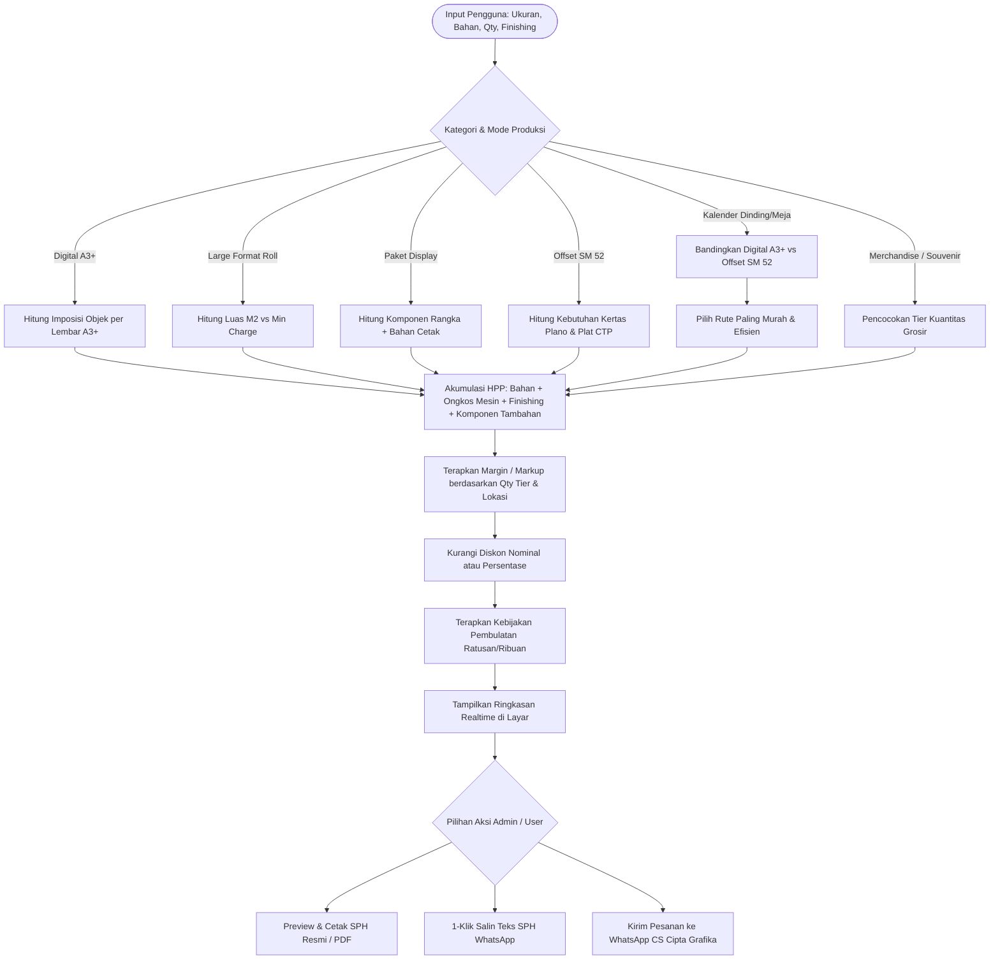

# Dokumentasi Sistem: Cipta Grafika Printing Management & Interactive Estimator System

> **Versi Dokumentasi:** 1.0.0  
> **Terakhir Diperbarui:** 14 November 2026  
> **Status Sistem:** Selesai (Production Ready)  
> **Lisensi:** Proprietary - Cipta Grafika  

---

## Daftar Isi
1. [Gambaran Umum & Identitas Sistem](#1-gambaran-umum--identitas-sistem)
2. [Arsitektur & Tech Stack](#2-arsitektur--tech-stack)
3. [Alur Bisnis & Logika Estimasi](#3-alur-bisnis--logika-estimasi)
4. [Entity Relationship Diagram (ERD)](#4-entity-relationship-diagram-erd)
5. [Kamus Database & Relasi Tabel](#5-kamus-database--relasi-tabel)
6. [Katalog Fitur & Spesifikasi Modul Estimator](#6-katalog-fitur--spesifikasi-modul-estimator)
   - [6.1. Modul Digital Print A3+](#61-modul-digital-print-a3)
   - [6.2. Modul Large Format & Paket Display](#62-modul-large-format--paket-display)
   - [6.3. Modul Cetak Offset & Brosur](#63-modul-cetak-offset--brosur)
   - [6.4. Modul Cetak Kalender (Dinding & Meja)](#64-modul-cetak-kalender-dinding--meja)
   - [6.5. Modul Merchandise, Identitas Korporat & Form Administrasi](#65-modul-merchandise-identitas-korporat--form-administrasi)
7. [Fitur Interaktif & Keunggulan UI/UX](#7-fitur-interaktif--keunggulan-uiux)
8. [Panduan Instalasi, Seeder & Deployment](#8-panduan-instalasi-seeder--deployment)
9. [Daftar Rute & Endpoint Sistem](#9-daftar-rute--endpoint-sistem)

---

## 1. Gambaran Umum & Identitas Sistem

**Cipta Grafika Printing Management & Interactive Estimator System** adalah sistem ERP dan kalkulator estimasi biaya percetakan end-to-end yang dirancang khusus untuk industri percetakan modern di Indonesia. 

Sistem ini memecahkan kompleksitas perhitungan HPP (Harga Pokok Produksi), pemilihan mesin cetak (Digital vs Offset), margin profit, biaya finishing, serta konversi ukuran bahan (plano/roll/lembar) ke produk jadi secara instan, akurat, dan transparan.

### Tujuan Utama Sistem:
1. **Presisi Finansial Otomatis:** Menghilangkan salah hitung biaya cetak, bahan terbuang (*waste*), dan ongkos finishing.
2. **Dual-Portal Terintegrasi:**
   - **Portal Admin:** Kendali penuh atas master data, biaya mesin, harga bahan vendor, margin tier, aturan pembulatan, dan kalkulator multi-modul dengan pratinjau Surat Penawaran Harga (SPH).
   - **Portal Pelanggan (User):** Katalog produk visual interaktif, kalkulator mandiri (*self-service estimator*) berbasis kartu pilihan ramah pengguna (*choice cards*), dan pesanan 1-klik ke WhatsApp.
3. **Standarisasi Penawaran Resmi:** Menghasilkan Surat Penawaran Harga (SPH) terstandarisasi yang siap cetak/PDF dan format pesan WhatsApp resmi dalam 1 klik.

---

## 2. Arsitektur & Tech Stack

Sistem dibangun menggunakan arsitektur monolitik modern berbasis **Laravel 12 (MVC Pattern)** dengan performa tinggi dan keterpisahan logika yang terstruktur rapi.

```
+-----------------------------------------------------------------------------------+
|                                 USER LAYER                                        |
|  [Admin Dashboard & Estimators]                 [Public Catalog & User Estimator] |
|  - Realtime JS Engine (Debounced)               - Interactive Choice Cards        |
|  - SPH Modal & Print Preview                    - Dynamic Tier Price Badges       |
|  - 1-Click WhatsApp SPH Generator               - Direct WhatsApp CTA             |
+-----------------------------------------------------------------------------------+
                                        | (AJAX / REST)
+-----------------------------------------------------------------------------------+
|                              APPLICATION LAYER (Laravel 12)                       |
|  [Controllers & Estimation Engines]                                               |
|  - EstimationCT (A3+ & Large Format)       - MerchandiseEstimationCT              |
|  - OffsetEstimationCT (SM 52 vs A3+)       - CalendarEstimationCT                 |
|  - CatalogCT (Public Estimators)           - Master Data Controllers (CRUD/Excel) |
+-----------------------------------------------------------------------------------+
|                             SERVICES & BUSINESS LOGIC                             |
|  - Imposition Engine (Up-Count A3+/Plano)  - Dual-Engine Optimizer (Digital/Offset)|
|  - Multi-tier Volume Pricing Calculators   - Multi-vendor Outsourcing Selector    |
|  - Dynamic Rounding & Margin Policies      - WhatsApp SPH Formatter Engine        |
+-----------------------------------------------------------------------------------+
                                        | (Eloquent / Query Builder)
+-----------------------------------------------------------------------------------+
|                                 DATA LAYER                                        |
|  - PostgreSQL (Production VPS) / SQLite (Local Dev)                               |
|  - Maatwebsite Excel (Import / Export Service)                                    |
|  - Storage Engine (Public Image Assets / WebP Fallbacks)                          |
+-----------------------------------------------------------------------------------+
```

### Rincian Teknologi:
- **Backend Framework:** Laravel 12.x (PHP 8.2+)
- **Database:** PostgreSQL (Production VPS) / SQLite (Local Testing)
- **Frontend Engine:** Blade Templating, Tailwind CSS, Vanilla JS (ES6+), Select2, DataTables, Bootstrap Icons
- **Import/Export:** Maatwebsite Excel (`maatwebsite/excel` v3.1)
- **Desain UI:** Dukungan penuh Dark Mode & Light Mode dengan variabel CSS konsisten

---

## 3. Alur Bisnis & Logika Estimasi

Berikut adalah alur komputasi estimasi harga yang diterapkan secara konsisten di seluruh modul:



---

## 4. Entity Relationship Diagram (ERD)

Berikut adalah diagram relasi entitas lengkap yang memetakan seluruh tabel basis data sistem:

```mermaid
erDiagram
    USERS ||--o{ USER_ROLES : has
    ROLES ||--o{ USER_ROLES : assigned_to

    M_LOCATIONS ||--o{ M_MATERIAL_PRICES : defines
    M_LOCATIONS ||--o{ M_PRICING_RULES : applies
    M_LOCATIONS ||--o{ M_PRODUCTION_COSTS : defines

    M_VENDORS ||--o{ M_MATERIAL_PRICES : supplies
    M_VENDORS ||--o{ M_PRICING_RULES : applies

    M_CATEGORIES ||--o{ M_MATERIALS : categorizes
    M_CATEGORIES ||--o{ M_DISPLAY_PRODUCTS : contains
    
    M_ENGINES ||--o{ M_ENGINE_MATERIALS : supports
    M_ENGINES ||--o{ M_PRICING_RULES : configured_for
    
    M_MATERIALS ||--o{ M_ENGINE_MATERIALS : used_by
    M_MATERIALS ||--o{ M_MATERIAL_SIZES : has_sizes
    M_MATERIALS ||--o{ M_DISPLAY_PRODUCT_CONFIGURATIONS : used_in
    
    M_MATERIAL_SIZES ||--o{ M_MATERIAL_PRICES : priced_at
    
    M_LAMINATIONS ||--o{ M_LAMINATION_SIZES : has
    M_LAMINATIONS ||--o{ M_LAMINATION_PRICING_RULES : governed_by
    
    M_CUTTINGS ||--o{ M_CUTTING_SIZES : has
    
    M_DISPLAY_PRODUCTS ||--o{ M_DISPLAY_PRODUCT_IMAGES : has_gallery
    M_DISPLAY_PRODUCTS ||--o{ M_DISPLAY_PRODUCT_CONFIGURATIONS : configured_with
    M_DISPLAY_PRODUCTS ||--o{ M_DISPLAY_PRODUCT_COMPONENTS : composed_of
    
    M_OFFSET_PRODUCTS ||--o{ M_OFFSET_PRICING_RULES : priced_by
    M_OFFSET_PLANO_MATERIALS }o--|| M_MATERIALS : references
    
    M_CALENDAR_PRODUCTS ||--o{ M_CALENDAR_PRICING_RULES : priced_by
    M_CALENDAR_MATERIALS }o--|| M_MATERIALS : based_on
    
    T_ESTIMATIONS ||--o{ T_ESTIMATION_ITEMS : contains

    USERS {
        bigint id PK
        string name
        string email
        string password
    }

    M_LOCATIONS {
        bigint id PK
        string name
        string code
        string address
    }

    M_ENGINES {
        bigint id PK
        string name
        string code
        string engine_type
    }

    M_CATEGORIES {
        bigint id PK
        string name
        string slug
    }

    M_MATERIALS {
        bigint id PK
        bigint category_id FK
        string name
        string code
        string unit
    }

    M_MATERIAL_SIZES {
        bigint id PK
        bigint material_id FK
        decimal width
        decimal length
    }

    M_MATERIAL_PRICES {
        bigint id PK
        bigint material_size_id FK
        bigint location_id FK
        bigint vendor_id FK
        decimal price
        decimal hpp
    }

    M_DISPLAY_PRODUCTS {
        bigint id PK
        string name
        string code
        string rangka
    }

    M_OFFSET_PLANO_MATERIALS {
        bigint id PK
        string material_name
        decimal width
        decimal length
        decimal price_per_plano
    }

    M_OFFSET_PLATES {
        bigint id PK
        string plate_name
        string machine_name
        decimal price_per_plate
    }

    M_OFFSET_PRINT_COSTS {
        bigint id PK
        string machine_name
        decimal base_cost
        decimal cost_per_1000_runs
    }

    M_CALENDAR_PRODUCTS {
        bigint id PK
        string calendar_type
        string product_name
        string size_label
        int default_leaf_count
    }

    M_LANYARD_PRICINGS {
        bigint id PK
        string width_type
        string package_type
        int min_qty
        int max_qty
        decimal price
    }

    M_MUG_PRICINGS {
        bigint id PK
        string name
        string tier_label
        int min_qty
        int max_qty
        decimal price
    }

    M_PVC_CARD_PRICINGS {
        bigint id PK
        string name
        string tier_label
        int min_qty
        int max_qty
        decimal price
    }

    M_AKRILIK_UV_PRICINGS {
        bigint id PK
        string name
        string spec_label
        decimal price
    }

    M_PLAKAT_PRICINGS {
        bigint id PK
        string material_type
        string thickness
        string base_type
        boolean with_box
        decimal price
    }

    M_NAME_TAG_PRICINGS {
        bigint id PK
        string variant
        string fastener
        decimal price
    }

    M_NOTA_PRICINGS {
        bigint id PK
        string paper_type
        int ply
        int ink_colors
        decimal price
    }

    T_ESTIMATIONS {
        bigint id PK
        string estimation_code
        string customer_name
        decimal total_price
        decimal total_hpp
        decimal profit
    }
```



---

## 5. Kamus Database & Relasi Tabel

### 5.1. Domain Master Data Pokok
| Nama Tabel | Deskripsi | Kunci Utama | Kunci Asing / Relasi |
|---|---|---|---|
| `users` | Akun pengguna admin dan manajemen | `id` | - |
| `roles` & `user_roles` | Hak akses & pembagian peran (RBAC) | `id` | `user_id`, `role_id` |
| `m_locations` | Daftar cabang / workshop percetakan | `id` | - |
| `m_vendors` | Vendor rekanan outsourcing cetak / bahan | `id` | - |
| `m_categories` | Kategori produk cetak (A3+, Banner, Offset, dll) | `id` | - |
| `m_engines` | Mesin cetak internal & eksternal | `id` | - |
| `m_materials` | Master jenis bahan / kertas | `id` | `category_id` |
| `m_material_sizes` | Ukuran lebar/panjang bahan standar | `id` | `material_id` |
| `m_material_prices` | Harga beli/HPP bahan per ukuran & lokasi | `id` | `material_size_id`, `location_id`, `vendor_id` |
| `m_engine_materials` | Tabel pivot kompatibilitas mesin dan bahan | `id` | `engine_id`, `material_id` |

### 5.2. Domain Biaya Finishing & Cutting
| Nama Tabel | Deskripsi | Kunci Utama | Fitur Utama |
|---|---|---|---|
| `m_laminations` | Jenis laminasi (Doff, Glossy, Panas, Dingin) | `id` | Pengelompokan roll vs lembar |
| `m_lamination_sizes` | Ukuran lebar roll laminasi | `id` | Multi-ukuran roll |
| `m_cuttings` & `m_cutting_sizes` | Master pisau & ukuran cutting | `id` | Potong manual vs Digital Contour |
| `m_digital_cutting_production_costs` | Tarif ongkos cutting A3+ | `id` | Per lembar / per meter lari |
| `m_digital_potong_production_costs` | Ongkos potong sisir standar | `id` | Minimal ongkos potong |

### 5.3. Domain Paket Display (Banner Rangka)
| Nama Tabel | Deskripsi | Kunci Utama | Fitur Utama |
|---|---|---|---|
| `m_display_products` | Paket produk display (Roll Up, X-Banner, Door Frame) | `id` | Rangka + media cetak |
| `m_display_product_images` | Foto produk display untuk katalog | `id` | Multi-image preview |
| `m_display_product_configurations` | Konfigurasi material banner yang cocok | `id` | Relasi ke material |
| `m_display_product_components` | Rincian komponen rangka & aksesoris | `id` | Rincian HPP rangka |
| `m_display_product_component_prices` | Harga komponen cetak 1 sisi & 2 sisi | `id` | Tiering harga display |

### 5.4. Domain Offset & Brosur
| Nama Tabel | Deskripsi | Kunci Utama | Fitur Utama |
|---|---|---|---|
| `m_offset_products` | Master ukuran brosur jadi (A4, A5, DL, dll) | `id` | Muat per rim & panjang-lebar |
| `m_offset_plano_materials` | Kertas plano khusus offset (Art Paper, HVS) | `id` | Ukuran plano (65x90, 65x100, 79x109) |
| `m_offset_plates` | Plat CTP aluminium 4 warna (CMYK) | `id` | Tarif per set plat mesin SM 52 |
| `m_offset_print_costs` | Ongkos cetak mesin offset SM 52 | `id` | Ongkos dasar (min insit) + per 1.000 putar |
| `m_offset_pricing_rules` | Margin tiering brosur offset | `id` | Berdasarkan kuantitas rim |

### 5.5. Domain Kalender
| Nama Tabel | Deskripsi | Kunci Utama | Fitur Utama |
|---|---|---|---|
| `m_calendar_products` | Tipe kalender dinding & kalender meja | `id` | Orientasi, ukuran, & jumlah daun |
| `m_calendar_materials` | Bahan kertas kalender (AP 150, AP 210, AC 260) | `id` | Tarif lembaran A3+ & plano offset |
| `m_calendar_components` | Dudukan hardboard, spiral wire-o, klem seng | `id` | HPP per pcs & biaya rakit |
| `m_calendar_pricing_rules` | Margin persentase berjenjang kalender | `id` | Rule markup volume tiering |

### 5.6. Domain Merchandise, Identitas Korporat & Form Administrasi
| Nama Tabel | Deskripsi | Kunci Utama | Fitur Utama |
|---|---|---|---|
| `m_lanyard_pricings` | Pricelist tali lanyard 2cm & 2.5cm | `id` | Tali saja vs 1 Set Holder + PVC |
| `m_name_tag_pricings` | Pricelist papan nama dada akrilik | `id` | Biasa, Resin, Resin Emas, Peniti/Magnet |
| `m_plakat_pricings` | Pricelist plakat akrilik & kayu | `id` | Tebal 2mm, 3mm, 5mm, 1cm & Opsi Box Bludru |
| `m_nota_pricings` | Pricelist buku nota NCR & HVS | `id` | 1-4 Ply, 1-3 Warna Tinta (50 & 100 lembar) |
| `m_mug_pricings` | Pricelist Mug Sublimasi SNI | `id` | 6 Tier kuantitas grosir resmi |
| `m_pvc_card_pricings` | Pricelist Kartu ID Card / KTA PVC | `id` | 6 Tier kuantitas cetak lepasan |
| `m_akrilik_uv_pricings` | Pricelist Akrilik UV 2 Muka | `id` | Akrilik cetak UV mandiri |

---

## 6. Katalog Fitur & Spesifikasi Modul Estimator

Sistem memiliki **5 modul estimator utama** yang tersedia di sisi Admin dan Pelanggan:

### 6.1. Modul Digital Print A3+
- **Fungsi:** Mengkalkulasi cetak digital lembaran A3+ (ukuran standar cetak 31 × 47 cm atau 32 × 48 cm).
- **Metode Imposisi:**
  - *Hitung Layout Otomatis:* Memasukkan ukuran jadi (misal 9 × 5.5 cm kartu nama), sistem menghitung otomatis berapa objek yang muat per lembar A3+ beserta jumlah total lembar yang dibutuhkan.
  - *Direct Sheet:* Input langsung jumlah lembar A3+ yang diinginkan.
- **Finishing Terintegrasi:** Laminasi Doff/Glossy panas/dingin (1 sisi / 2 sisi), Cutting Die-Cut / Kiss-Cut / Potong Sisir Standar.
- **Komponen Tambahan:** Fitur repeater dinamis untuk menambahkan aksesoris seperti Eyelet (mata ayam), double tape, packaging kardus, dll.
- **Output:** Total HPP, Margin, Harga per Lembar A3+, Harga per Pcs Produk Jadi.

### 6.2. Modul Large Format & Paket Display
- **Fungsi:** Mengkalkulasi cetak meteran luar/dalam ruangan (Flexi Banner, Albatros, Sticker Vinyl, Backlite) dan paket rangka display.
- **Mode Cetak:**
  - *Roll Meteran:* Input panjang × lebar (cm) dan jumlah. Sistem menghitung luas meter persegi ($m^2$) dan menerapkan aturan *Minimum Charge Billing* (misal minimal dihitung $1\ m^2$).
  - *Paket Display:* Memilih produk display siap pakai (X-Banner, Y-Banner, Roll Up Banner 60x160 / 80x200 cm, Door Frame Standar).
- **Finishing:** Siming (lipat pres keliling), Mata ayam (mata ikan) 4 sudut, Kolong atas-bawah, Laminasi roll dingin.
- **Multi-Vendor:** Pilihan cetak internal mesin sendiri atau outsourcing vendor pihak ketiga dengan komputasi HPP otomatis.

### 6.3. Modul Cetak Offset & Brosur
- **Fungsi:** Mengkalkulasi cetak brosur, flyer, formulir massal (1.000 s/d puluhan ribu lembar).
- **Dual-Engine Analyzer:**
  - Sistem secara otomatis menghitung biaya pada dua mesin sekaligus: **Mesin Digital A3+** dan **Mesin Offset Heidelberg SM 52**.
  - Sistem menampilkan kartu rekomendasi rute paling ekonomis (Digital untuk volume kecil < 2 rim; Offset SM 52 untuk volume $\ge$ 3 rim).
- **Logika Offset SM 52:**
  - Efisiensi potong lembar plano (misal 1 plano potong 4, 8, atau 16 ukuran jadi).
  - Biaya Plat CTP 4 warna (CMYK).
  - Ongkos cetak dasar (*insit*) + biaya kelipatan per 1.000 putaran mesin.
- **Matriks Simulasi Kuantitas:** Tabel simulasi live perbandingan kuantitas 1 s/d 20 rim.

### 6.4. Modul Cetak Kalender (Dinding & Meja)
- **Fungsi:** Kalkulasi kalender dinding (klem seng / spiral) dan kalender meja (dudukan board + spiral).
- **Varian Produk:**
  - *Kalender Dinding:* Ukuran 30x42, 30x46, 38x53, 46x64, 50x70 cm. Daun 1 lembar (poster), 2, 3, 4, 6, 7 (2 bulanan + cover), 12, dan 13 lembar.
  - *Kalender Meja:* Ukuran 21x15 cm Landscape/Portrait. Dudukan Hardboard Boot 30 lapis linen / cetak printing full color, jilid ring spiral kawat ganda (wire-o).
- **Algoritma Rekomendasi:** Sistem memilih otomatis rute Digital A3+ atau Offset SM 52 yang termurah berdasarkan kuantitas pesanan.

### 6.5. Modul Merchandise, Identitas Korporat & Form Administrasi
Tujuh lini produk cetak khusus siap estimasi:
1. **Mug Sublimasi:** Keramik SNI kualitas Super White (11 oz / 325 ml), cetak full wrap anti-luntur, sudah termasuk box kardus satuan. Kuantitas tiering 1-5 pcs s/d >51 pcs.
2. **Kartu PVC:** Bahan tebal standar kartu ATM (8.6 × 5.4 cm), anti-air, cetak 2 sisi high-definition. Tiering 1 pcs s/d 300 pcs.
3. **Akrilik UV 2 Muka:** Akrilik bening 3mm dengan cetak flatbed UV bolak-balik berketahanan gores tinggi.
4. **Lanyard & ID Card:** Tali lanyard lebar 2 cm dan 2.5 cm, pilihan Tali Saja atau Paket Lengkap 1 Set (Tali + Card Holder Transparan + Kartu PVC).
5. **Name Tag (Papan Nama Dada):** Ukuran 8 × 2 cm dengan varian Biasa, Pelapis Resin Cembung, Resin Emas Eksklusif, serta pilihan pengait Peniti atau Magnet Neodymium kuat.
6. **Plakat Akrilik & Kayu:** Ukuran 20 × 15 cm tebal 2mm, 3mm, 5mm, 1cm dengan pilihan dudukan akrilik atau dudukan hitam, plus opsi kemasan Kotak Bludru Eksklusif.
7. **Buku Nota NCR & HVS:** Ukuran 1 folio potong sesuai kebutuhan, isi 50 sheet (NCR) atau 100 sheet (HVS), pilihan 1-4 ply dan 1-3 warna tinta cetak.

---

## 7. Fitur Interaktif & Keunggulan UI/UX

### 7.1. Live Debounced Real-Time Calculation
- Input form (ukuran, kuantitas, bahan, diskon) tidak memerlukan klik tombol submit reload.
- Sistem menggunakan debounce 350ms: saat pengguna selesai mengetik angka, kalkulasi AJAX berjalan otomatis di latar belakang dan memperbarui komponen ringkasan harga secara halus (*smooth*).

### 7.2. Fitur 1-Klik "Salin Penawaran WhatsApp" (SPH)
Tersedia di semua estimator admin:
- Menghasilkan format pesan teks resmi yang rapi, profesional, dan lengkap.
- **Feedback Haptik Visual:** Tombol berubah warna hijau dengan teks `Tersalin ke Clipboard!` selama 2.2 detik.
- **Toast Notification:** Muncul notifikasi slide-in elegan di sudut kanan atas layar memberitahukan teks telah siap di-paste ke WhatsApp.
- **Contoh Format Output SPH WhatsApp:**
  ```text
  *SURAT PENAWARAN HARGA (SPH) - CIPTA GRAFIKA*
  Kepada Yth: PT Maju Jaya Bersama
  Tanggal: 14 November 2026
  ---------------------------------------------
  *Produk:* Cetak Brosur Digital Print A3+ (Brosur A4 - A4 (21 x 29.7 cm))
  *Material / Bahan:* Art Paper 150 gsm
  *Sisi Cetak:* 2 Sisi (Bolak-Balik)
  *Kuantitas:* 500 pcs (125 lbr A3+)
  *Diskon (5%):* -Rp 25.000 (Subtotal: Rp 500.000)
  *Total Estimasi:* *Rp 475.000* (Rp 950 / pcs)
  *Estimasi Pengerjaan:* 2 Hari Kerja
  *Catatan Khusus:* Finishing lipat 3 brosur rapi
  ---------------------------------------------
  _Harga resmi terstandar dan berlaku selama penawaran masih aktif._
  Terima kasih telah mempercayakan kebutuhan percetakan & merchandise kepada Cipta Grafika!
  ```

### 7.3. User-Friendly Choice Cards pada Katalog Publik
- Menghindari penyajian tabel data mentah yang membingungkan bagi pembeli awam.
- Data ukuran, bahan, area cetak, dan finishing disajikan dalam bentuk **Kartu Pilihan Interaktif (`.estimator-choice-button`)** yang dapat diklik dengan status aktif warna emas/primer.
- Badge status tier grosir aktif secara otomatis berpindah saat kuantitas pesanan dinaikkan.
- Tombol WhatsApp Call-to-Action langsung membuka aplikasi WhatsApp dengan pesan terformat otomatis.

### 7.4. Pratinjau & Cetak Surat Penawaran (Print / PDF Ready)
- Setiap estimator admin dilengkapi modal pratinjau surat berkop resmi Cipta Grafika.
- Mengatur otomatis nama pelanggan, tanggal penawaran, tanggal kedaluwarsa penawaran (*validity presets:* 7 hari, 14 hari, 30 hari), dan tabel rincian item.
- Terintegrasi langsung dengan perintah cetak browser (`window.print()`) yang telah diatur stylesheet media cetaknya (`@media print`) sehingga tampilan bersih tanpa tombol navigasi.

---

## 8. Panduan Instalasi, Seeder & Deployment

### 8.1. Kebutuhan Server
- **PHP:** $\ge$ 8.2 (Ekstensi: `pdo_pgsql`, `pdo_sqlite`, `zip`, `gd`, `mbstring`, `openssl`, `bcmath`)
- **Web Server:** Nginx / Apache
- **Database Server:** PostgreSQL 14+ (disarankan untuk VPS produksi)
- **Node.js:** v18+ & npm v9+

### 8.2. Langkah Instalasi Awal
```bash
# 1. Clone repository
git clone <URL_REPOSITORY>
cd cipta-grafika-printing-management

# 2. Install dependensi PHP
composer install --no-dev --optimize-autoloader

# 3. Konfigurasi Environment
cp .env.example .env
nano .env

# Pastikan konfigurasi database di .env:
# DB_CONNECTION=pgsql
# DB_HOST=127.0.0.1
# DB_PORT=5432
# DB_DATABASE=cipta_grafika
# DB_USERNAME=postgres
# DB_PASSWORD=your_secure_password

# 4. Generate Application Key
php artisan key:generate

# 5. Jalankan Migrasi Database
php artisan migrate --force

# 6. Install dependensi aset frontend & build Vite
npm install
npm run build

# 7. Buat storage symbolic link
php artisan storage:link
```

### 8.3. Menjalankan Seeder Data Master
Sistem telah dilengkapi seeder idempoten yang aman dijalankan berulang kali tanpa merusak atau menduplikasi data yang sudah ada:

```bash
# Menjalankan seluruh seeder master data
php artisan db:seed --class=DatabaseSeeder --force

# Menjalankan seeder master merchandise tambahan (Mug, PVC Card, Akrilik UV)
php artisan db:seed --class=MerchandiseAdditionalMasterSeeder --force

# Menjalankan seeder master offset & kalender
php artisan db:seed --class=OffsetMasterSeeder --force
php artisan db:seed --class=CalendarEstimatorSeeder --force
```

### 8.4. Optimasi Produksi (Production Caching)
Jalankan perintah ini setelah melakukan pembaruan kode atau migrasi:
```bash
php artisan config:cache
php artisan route:cache
php artisan view:cache
```

---

## 9. Daftar Rute & Endpoint Sistem

### 9.1. Rute Publik / Pelanggan
| Metode | Endpoint URL | Nama Rute | Deskripsi |
|---|---|---|---|
| `GET` | `/` | `user_home` | Halaman beranda katalog publik |
| `GET` | `/products` | `user_products` | Halaman daftar seluruh produk |
| `GET` | `/product-details` | `user_product_details` | Halaman detail & estimator interaktif produk |
| `GET` | `/baskets` | `user_baskets` | Keranjang belanja sementara pelanggan |
| `POST` | `/estimation/preview-lf` | `user_preview_lf_estimation` | Hitung estimasi Large Format untuk pelanggan |
| `POST` | `/estimation/preview-a3plus` | `user_preview_a3plus_estimation` | Hitung estimasi Digital A3+ untuk pelanggan |
| `POST` | `/estimation/preview-brosur` | `user_preview_brosur_estimation` | Hitung estimasi Brosur Offset untuk pelanggan |
| `POST` | `/estimation/preview-calendar` | `user_preview_calendar_estimation` | Hitung estimasi Kalender untuk pelanggan |

### 9.2. Rute Autentikasi & Dashboard Admin
| Metode | Endpoint URL | Nama Rute | Deskripsi |
|---|---|---|---|
| `GET` | `/admin/signin` | `admin_signin` | Halaman masuk staf/admin |
| `POST` | `/admin/signin` | `admin_signin_process` | Proses autentikasi masuk |
| `POST` | `/admin/logout` | `admin_logout` | Keluar sesi staf/admin |
| `GET` | `/admin` | `admin_home` | Dashboard analitik percetakan |

### 9.3. Rute Modul Estimator Admin
| Metode | Endpoint URL | Nama Rute | Deskripsi |
|---|---|---|---|
| `GET` | `/admin/estimations/create-a3plus` | `admin_create_a3plus_estimation` | Halaman estimator Digital Print A3+ |
| `POST` | `/admin/estimation/create-a3plus` | `admin_store_a3plus` | Eksekusi hitung realtime Digital Print A3+ |
| `GET` | `/admin/estimations/create-lf` | `admin_create_lf_estimation` | Halaman estimator Large Format & Display |
| `POST` | `/admin/estimation/create-lf` | `admin_store_lf` | Eksekusi hitung realtime Large Format & Display |
| `GET` | `/admin/estimations/create-offset` | `admin_create_offset_estimation` | Halaman estimator Cetak Offset & Brosur |
| `POST` | `/admin/estimations/calculate-offset` | `admin_calculate_offset` | Eksekusi hitung realtime Offset SM 52 vs Digital |
| `GET` | `/admin/estimations/create-calendar` | `admin_create_calendar_estimation` | Halaman estimator Kalender Dinding & Meja |
| `POST` | `/admin/estimations/calculate-calendar` | `admin_calculate_calendar_estimate` | Eksekusi hitung realtime Kalender |
| `GET` | `/admin/estimations/create-merchandise`| `admin_create_merchandise_estimation`| Halaman estimator Merchandise, Identitas & Form |
| `POST` | `/admin/estimations/calculate-merchandise`| `admin_calculate_merchandise_estimate`| Eksekusi hitung realtime Merchandise, Identitas & Form |

### 9.4. Rute Master Data & Aturan Harga (Admin)
| Endpoint Prefix | Modul Master | Kemampuan Utama |
|---|---|---|
| `/admin/categories/*` | Kategori Produk | CRUD, Bulk Delete, Export/Import Excel |
| `/admin/engines/*` | Mesin Cetak | CRUD, Konfigurasi kecepatan & biaya per putaran |
| `/admin/vendors/*` | Vendor Rekanan | CRUD, Kontak, Integrasi outsourcing |
| `/admin/materials/*` | Bahan / Kertas Cetak | CRUD, Relasi ukuran, Export/Import Excel |
| `/admin/material-prices/*`| Harga Bahan & HPP | Penetapan HPP bahan per lokasi dan vendor |
| `/admin/laminations/*` | Laminasi | Master ukuran roll & lembaran laminasi |
| `/admin/cuttings/*` | Cutting & Potong | Master pisau, cutting kontur, ongkos sisir |
| `/admin/displays/*` | Produk Display | Rangka banner, komponen display, multi-image |
| `/admin/offset-master/*` | Master Offset SM 52 | Plano, Plat CTP 4 warna, ongkos cetak, margin |
| `/admin/calendar-master/*`| Master Kalender | Tipe kalender, daun, dudukan board, spiral wire-o |
| `/admin/merchandise-master/*`| Master Merchandise | Lanyard, Name Tag, Plakat, Nota, Mug, PVC, Akrilik UV |
| `/admin/pricing-rules/*` | Aturan Margin | Kebijakan markup, margin tiering, pembulatan |
| `/admin/discounts/*` | Diskon & Kupon | Diskon persentase & nominal bertingkat |

---

## 10. Catatan Perawatan & Integritas Sistem

1. **Jaminan Nol Regresi (Zero Breakage Guarantee):**
   - Penambahan fitur tombol atau modifikasi UI di kemudian hari tidak boleh mengubah rumus formula dasar pada `OffsetEstimationCT.php`, `CalendarEstimationCT.php`, `EstimationCT.php`, atau `MerchandiseEstimationCT.php`.
2. **Kesesuaian Desain Responsif:**
   - Seluruh elemen antarmuka telah lolos uji responsivitas pada layar Ponsel (320px–640px), Tablet (768px–1024px), hingga Monitor Desktop resolusi tinggi (1920px+).
3. **Penyimpanan Gambar Produk:**
   - Gambar display produk disimpan di `public/images/display/` dan aset sampel di `public/images/sample-produk/` dengan format `.webp` atau `.jpg` yang dikompresi di bawah 1 MB demi performa muat halaman yang optimal.

---
*Dokumentasi ini disusun sebagai acuan resmi bagi tim pengembang (developer), staf operasional, administrator sistem, dan pemangku kepentingan Cipta Grafika.*
